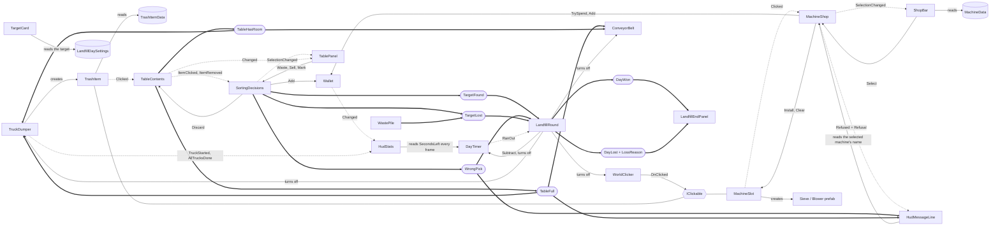

<div dir="rtl" lang="he">

# ביטקוין קבור: יום העבודה הראשון

משאיות שופכות זבל מהמזבלה על מסוע. השחקן קונה מכונות שממיינות את הזבל בשבילו, ממיין ביד את מה שמגיע לשולחן, ומחפש את המטרה של היום: ארגז כלים אדום. צריך למצוא אותו לפני שהיום נגמר, ובלי לזרוק אותו לפסולת בטעות.

מסמך העיצוב: [Buried-Bitcoin](https://github.com/Game-development-Ariel/Buried-Bitcoin)

## קישורים

* המשחק באיץ' (אפשר לשחק בדפדפן): [game-dev-ariel.itch.io/ex4-buried-bitcoin](https://game-dev-ariel.itch.io/ex4-buried-bitcoin)
* דיווח על שימוש בבינה מלאכותית: [AI_REPORT.md](AI_REPORT.md)

## איך מריצים

1. אחרי `git clone` מריצים `git lfs pull`, כי התמונות והצלילים שמורים ב-Git LFS.
2. ב-Unity Hub פותחים את התיקייה של המאגר, בגרסה 6000.3.25f1.
3. פותחים את הסצנה `Assets/Scenes/Landfill` ולוחצים Play.

הסצנה והפריפאבים נבנים מקוד ב-[LandfillSceneBuilder.cs](Assets/Scripts/Editor/LandfillSceneBuilder.cs). אחרי שינוי בכלים מריצים `Tools > Rebuild Scene`. הבנייה מחליפה את הסצנה ואת הפריפאבים, אבל הנכסים ב-`Assets/Data` נכתבים רק כשהם חדשים, אז מה שכווננו ב-Inspector נשאר.

בנייה לדפדפן: `Tools > Build WebGL`. הבנייה יוצאת ל-`../ex4-webgl-builds/ex4-buried-bitcoin`, מחוץ לתיקיית הפרויקט, כדי שלא תיכנס לגיט.

## איך משחקים

הכול בעכבר (או במגע):

* **חנות** (למטה משמאל): בוחרים מכונה ולוחצים על משבצת ריקה מעל המסוע. הנפה (100$) מפילה פריטים קטנים, המפוח (50$) מעיף פריטים קלים. לחיצה על מכונה שכבר הותקנה מוכרת אותה בחצי מחיר.
* **שולחן המיון** (מימין): לוחצים על פריט ובוחרים Waste, Sell או This is the target.
* כשהשולחן מלא (14 פריטים), המסוע והמשאית עוצרים. הם ממשיכים כשמתפנים שני מקומות.
* אחרי המשאית האחרונה כתוב למעלה "No more trucks today".
* **ניצחון**: מסמנים את ארגז הכלים האדום כמטרה.
* **הפסד**: הזמן נגמר, או שהמטרה הגיעה לפסולת (דרך מכונה, בלחיצה על Waste או Sell, או כי עפה אל מחוץ למתקן). בחירה לא נכונה ב-"This is the target" עולה 20 שניות, והפריט כבר לא מסומן, כך שלחיצה כפולה לא נותנת קנס כפול.
* כשהיום נגמר, המסוע, המשאית, השעון והלחיצות נעצרים.

## פיסיקה

המשחק מוצג מהצד, כדי שכוח הכבידה יעשה חלק מהמיון.

| תכונה | איפה | קובץ |
|---|---|---|
| Rigidbody2D | כל פריט שיוצא מהמשאית. הגודל והמשקל באים מהנתונים של הפריט | [TrashItem.cs](Assets/Scripts/Items/TrashItem.cs) |
| AddForce ו-AddTorque | המשאית זורקת כל פריט עם דחיפה וסיבוב | [TruckDumper.cs](Assets/Scripts/Trucks/TruckDumper.cs) |
| Collision2D | ערמת הפסולת בודקת במה היא פגעה. אם זה פריט המטרה, היום נכשל. אותו רכיב יושב גם על ארבעה גבולות בלתי נראים מחוץ למסך, כדי שפריט שעף מעל קיר לא ייפול לנצח | [WastePile.cs](Assets/Scripts/Machines/WastePile.cs) |
| אפקטורים (רשות) | המסוע הוא SurfaceEffector2D. המפוח הוא AreaEffector2D בלי סקריפט בכלל: הכוח שווה לכל הפריטים, אז רק הקלים מתרוממים. המהירות והכוח נמצאים ב-Day1Settings (`beltSpeed`, `blowerForce`). למפוח אין סקריפט, אז את `blowerForce` הבנאי כותב לפריפאב, ואחרי שינוי שלו מריצים `Tools > Rebuild Scene` | [ConveyorBelt.cs](Assets/Scripts/Machines/ConveyorBelt.cs), [Blower.prefab](Assets/Prefabs/Blower.prefab) |

יש גם טריגרים שבודקים תכונות: הנפה ([Sieve.cs](Assets/Scripts/Machines/Sieve.cs)) מבטלת את ההתנגשות בין פריט קטן למסוע (`Physics2D.IgnoreCollision`), והוא נופל דרכו. השולחן ([TableContents.cs](Assets/Scripts/Sorting/TableContents.cs)) סופר את הפריטים שבתוך הטריגר שמעליו.

## מבנה התיקיות

<div dir="ltr">

```
Assets/
├── Scripts/        BuriedBitcoin.asmdef (the game: Input System and uGUI)
│   ├── Trucks/     TruckDumper, TruckLoad
│   ├── Items/      TrashItem, TrashItemData
│   ├── Machines/   ConveyorBelt, MachineSlot, MachineData, Sieve, WastePile
│   ├── Shop/       MachineShop, Wallet
│   ├── Sorting/    TableContents, SortingDecisions
│   ├── Game/       LandfillRound, DayTimer, LandfillDaySettings, LossReason
│   ├── Events/     GameEvent, DayLostEvent   (ScriptableObject)
│   ├── Input/      IClickable, WorldClicker
│   ├── UI/         HudStats, HudMessageLine, TargetCard, ShopBar, TablePanel,
│   │               LandfillEndPanel, ResultOverlay, ScreenFader, ButtonFeel,
│   │               UiFactory, UiTheme, UiAnim
│   ├── Audio/      Sfx
│   ├── Core/       ObjectRemoval (removes an object correctly in Play mode and in edit mode)
│   └── Editor/     BuriedBitcoin.Editor.asmdef (editor only, adds URP 2D for the light)
│                   ProjectBuilder (the Tools menu), LandfillSceneBuilder, LandfillAssets,
│                   SceneParts, SetupTools, PlaceholderSprites
├── Tests/
│   ├── Shared/     BuriedBitcoin.Tests.Shared.asmdef: TestUtils, ClickCounter
│   ├── EditMode/   BuriedBitcoin.Tests.EditMode.asmdef (editor only)
│   │               Events, Economy, Game, Sorting, Trucks, Items, Machines,
│   │               Data, Scene, Editor, Architecture
│   └── PlayMode/   BuriedBitcoin.Tests.PlayMode.asmdef
│                   CoreLoopTests, MachineTests, LandfillScene, Components, UI, Input, Audio
├── Data/
│   ├── Day1Settings   rules, belt and blower, trucks, and the target
│   ├── Events/        TableFull, TableHasRoom, TargetFound, TargetLost, WrongPick, DayWon, DayLost
│   ├── Items/         Dirtclod, Plasticbag, Glassbottle, Tincan, Copperscrap, Rustybox, Redtoolbox
│   └── Machines/      Sieve, Blower
├── Prefabs/        TrashItem, Sieve, Blower
├── Resources/      Audio/Click, Fonts/ (CrimsonText, CourierPrime), UI/ (Button, Panel)
├── Scenes/         Landfill
├── Sprites/        Shapes/Square
└── Settings/       URP and Input System settings
```

</div>

`Game` מחזיקה את החוקים (מתי מנצחים ומפסידים), ו-`UI` מציגה. קוד המשחק לא מכיר את קוד הממשק: הממשק מאזין לאירועים של המשחק, ולא להפך. קוד המשחק גם לא כותב משפטים לשחקן: הוא שולח סיבה (`LossReason`, `MachineShop.Refusal`), והממשק בוחר את המילים.

### מה יש בנתונים

| נכס | מה יש בו |
|---|---|
| [Day1Settings](Assets/Data/Day1Settings.asset) (LandfillDaySettings) | כסף בהתחלה, אורך היום, מתי השעון נצבע באדום, הקנס על בחירה לא נכונה, כמה פריטים נכנסים לשולחן וכמה מקומות צריכים להתפנות כדי שהקו ימשיך, מהירות המסוע, כוח המפוח, המשאיות ומה יש בכל אחת, ופריט המטרה של היום |
| Items (TrashItemData) | שם, צבע, גודל, משקל, האם קטן (נופל בנפה), מחיר מכירה, ותיאור לכרטיס המטרה |
| Machines (MachineData) | שם, מחיר, שורת תיאור לחנות, והפריפאב שנוצר במשבצת |
| Events (GameEvent, DayLostEvent) | בלי ערכים. הנכס הוא רק נקודת המפגש בין מי שמרים את האירוע למי שמאזין |

## יחסי המחלקות

יש שני סוגי אירועים:

* **אירוע כנכס** ([GameEvent](Assets/Scripts/Events/GameEvent.cs), [DayLostEvent](Assets/Scripts/Events/DayLostEvent.cs), שנושא גם את הסיבה להפסד): ScriptableObject שרכיב אחד מרים ואחרים מאזינים לו. השולח והמאזינים לא מכירים זה את זה.
* **אירוע רגיל של C#** (`event Action`): כשהמאזין ממילא מחזיק הפניה לשולח, כמו ה-HUD שמציג את הכסף.

כל הרשמה נעשית ב-`OnEnable` ומבוטלת ב-`OnDisable`. יש שני יוצאים מן הכלל:

* **הפריטים על השולחן.** TableContents נרשם ללחיצות של פריט כשהפריט נכנס לטריגר שמעל השולחן (`OnTriggerEnter2D`), ומבטל כשהוא יוצא (`OnTriggerExit2D`) או כשממיינים אותו. גם פריט שנהרס בדרך אחרת יוצא מהרשימה, כי בהגדרות Physics 2D מסומן `Callbacks On Disable`, ואז יוניטי שולחת `OnTriggerExit2D` גם על קוליידר שנהרס. אם מכבים את ההגדרה הזאת, פריט שנהרס יישאר ברשימה. כשהשולחן עצמו נהרס, הוא מבטל את כל ההרשמות שנשארו ב-`OnDestroy` (ולא ב-`OnDisable`, כי יוניטי שולחת הודעות טריגר גם לסקריפט כבוי).
* **כפתורים.** `onClick.AddListener` נעשה פעם אחת ב-`Awake`, כשהכפתור נוצר. הכפתור והמאזין נוצרים ונהרסים יחד, אז אין מה לבטל.

ובלי אירוע בכלל: HudStats קורא את `DayTimer.SecondsLeft` בכל פריים, כי השעון משתנה כל הזמן ממילא.

בתרשים: מלבן הוא מחלקה, צורה מעוגלת היא אירוע כנכס (חץ עבה), חץ מקווקו הוא אירוע רגיל של C#, וחץ רגיל הוא קריאה ישירה. כמעט כל המחלקות קוראות גם את Day1Settings, ואת החצים האלה השמטנו כדי שהתרשים יהיה קריא.

<div dir="ltr">



</div>

| אירוע | מי שולח | מי מקבל |
|---|---|---|
| TableFull, TableHasRoom (נכסים) | TableContents | ConveyorBelt (עוצר וממשיך), TruckDumper (מחכה). את TableFull מקבל גם HudMessageLine |
| TargetFound, WrongPick (נכסים) | SortingDecisions | LandfillRound (ניצחון, או קנס זמן). את WrongPick מקבל גם HudMessageLine |
| TargetLost (נכס) | WastePile (גם הגבולות שמחוץ למסך), SortingDecisions | LandfillRound |
| DayWon (נכס) | LandfillRound | LandfillEndPanel |
| DayLost (נכס, עם LossReason) | LandfillRound | LandfillEndPanel, שבוחר את המשפט לפי הסיבה |
| TrashItem.Clicked | TrashItem | TableContents, רק כל עוד הפריט על השולחן |
| MachineSlot.Clicked | MachineSlot | MachineShop |
| TableContents.ItemClicked, ItemRemoved | TableContents | SortingDecisions (בוחר פריט, ומבטל בחירה כשהפריט יורד מהשולחן) |
| TableContents.Changed | TableContents | TablePanel |
| SortingDecisions.SelectionChanged | SortingDecisions | TablePanel |
| MachineShop.SelectionChanged | MachineShop | ShopBar (מסמן את המכונה שנבחרה) |
| MachineShop.Refused (עם Refusal) | MachineShop | HudMessageLine, שבוחר את המשפט |
| Wallet.Changed | Wallet | HudStats |
| TruckDumper.TruckStarted, AllTrucksDone | TruckDumper | HudStats |
| DayTimer.RanOut | DayTimer | LandfillRound |
| בלי אירוע: `DayTimer.SecondsLeft` | DayTimer | HudStats קורא אותו בכל פריים |

כל מחלקה עושה דבר אחד:

| מחלקה | מה היא עושה |
|---|---|
| TableContents | מחזיקה את רשימת הפריטים שעל השולחן, ומודיעה כשהוא מלא וכשיש בו מקום |
| SortingDecisions | מבצעת את ההחלטה של השחקן על הפריט שנבחר: פסולת, מכירה, או "זאת המטרה" |
| MachineShop | הופכת לחיצה על משבצת לעסקה: משבצת ריקה קונה את המכונה שנבחרה, ומשבצת עם מכונה מוכרת אותה |
| HudStats | מציגה את הכסף, הזמן והמשאית |
| HudMessageLine | מציגה הודעה קצרה לכמה שניות, כשמשהו דורש תשומת לב |
| TargetCard | מציגה את התיאור של המטרה של היום |

## החלטות ארכיטקטורה

**1. מבט מהצד, והפיסיקה ממיינת.** במסמך העיצוב המתקן מוצג מלמעלה, וכל מכונה הייתה צריכה קוד שמחליט לאן כל פריט הולך. מהצד, כוח הכבידה עושה את העבודה: הנפה רק מבטלת התנגשות והפריט הקטן נופל, והמפוח הוא AreaEffector2D בלי שורת קוד, שהכוח שלו מרים רק פריטים קלים. החלופה (מבט מלמעלה עם רשת ומסלולים) הייתה דורשת לכתוב את התנועה בעצמנו, והמטלה מבקשת פיסיקה.

**2. מכונות כנתונים.** כל מכונה היא נכס MachineData (שם, מחיר, תיאור) ופריפאב. החנות, המשבצות והארנק מכירים רק MachineData, ולא יודעים מה זו נפה או מפוח. החלופה הייתה `switch` על סוג המכונה בחנות, ואז כל מכונה חדשה הייתה משנה את החנות.

**3. שולחן מלא עוצר את הקו דרך אירוע.** כשהשולחן מתמלא הוא מרים `TableFull`, והמסוע, המשאית וה-HUD מגיבים כל אחד לבד. החלופה הייתה שהשולחן יחזיק הפניות למסוע ולמשאית ויקרא להם, אבל אז השולחן היה צריך להכיר כל חלק של הקו, ומכונה חדשה שצריכה לעצור הייתה משנה אותו.

**4. החנות מוצאת את המכונות לבד, מהנכסים.** כשבונים את הסצנה, הבנאי מחפש את כל נכסי ה-MachineData בפרויקט (`AssetDatabase.FindAssets("t:MachineData")`), ממיין לפי מחיר ושם אותם ברשימה של ShopBar. כך מכונה חדשה היא באמת רק נכס ופריפאב. החלופה הראשונה הייתה רשימה שכתובה בבנאי, וזה מה שהיה לפני כן: כל מכונה חדשה דרשה שינוי בקוד, ובנייה מחדש מחקה מכונה שהוספנו ידנית ב-Inspector. החלופה השנייה הייתה `Resources.LoadAll` בזמן המשחק, אבל אז כל הנכסים היו צריכים לשבת בתיקיית Resources, והרשימה לא הייתה נראית ב-Inspector.

כל המספרים לכוונון נמצאים בנכסים ב-`Assets/Data` (הגדרות היום, המסוע והמפוח, המשאיות, סוגי הפריטים, המכונות) או בשדות Inspector. מספרי הפריסה של המסכים הם קבועים עם שמות בראש כל מחלקת ממשק.

## איך מוסיפים דברים

**פריט חדש.** יוצרים נכס TrashItemData (`Create > Landfill > Trash Item`) ומוסיפים אותו למשאית בנכס [Day1Settings](Assets/Data/Day1Settings.asset). אין שינוי בקוד: הפריפאב TrashItem לוקח מהנכס צבע, גודל ומשקל, והמכונות בודקות את התכונות שבנכס. כדי שהוא יהיה המטרה של היום, גוררים אותו לשדה `target` ב-Day1Settings וכותבים לו `description`.

**מכונה חדשה (המקבילה ל"אויב חדש" כאן), למשל מגנט.**
1. מוסיפים שדה `isMetal` ל-TrashItemData ומסמנים אותו בפריטים המתאימים.
2. כותבים סקריפט `Magnet.cs` בתיקייה `Machines`, שמושך פריטים שיש להם `isMetal`.
3. יוצרים פריפאב עם הסקריפט וטריגר מעל המסוע (כמו Sieve.prefab).
4. יוצרים נכס MachineData (`Create > Landfill > Machine`) עם שם, מחיר ותיאור, וגוררים אליו את הפריפאב.
5. מריצים `Tools > Rebuild Scene`. הבנאי מוצא את הנכס החדש ומוסיף כפתור לחנות.

החנות, המשבצות והכסף לא משתנים, כי הם מכירים רק MachineData.

## סינגלטון ומשתנים סטטיים

אין סינגלטון.

| איפה | מה | למה |
|---|---|---|
| [Sfx](Assets/Scripts/Audio/Sfx.cs) | מחלקה סטטית עם AudioSource אחד ומילון של הצלילים שכבר נטענו | הקליק של Play again צריך להמשיך גם כשהסצנה נטענת מחדש. המילון חוסך טעינה מ-Resources בכל לחיצה. אין בהם מצב של המשחק, ובין הפעלות של Play הם בטוחים: AudioSource שנהרס נוצר מחדש, וצליל שנפרק נטען מחדש |
| [ScreenFader](Assets/Scripts/UI/ScreenFader.cs) | `FadeAndLoad` סטטית ודגל `isFading` | המסך השחור חייב לשרוד את טעינת הסצנה כדי להתבהר אחריה. הדגל מונע טעינה כפולה. ב-Project Settings כבוי ה-Domain Reload, אז משתנה סטטי לא מתאפס לבד בין הפעלות של Play. לכן `ResetStatics` עם `[RuntimeInitializeOnLoadMethod(SubsystemRegistration)]` מאפס את הדגל בתחילת כל הפעלה |
| UiFactory, UiAnim, UiTheme, ResultOverlay, ObjectRemoval | מחלקות סטטיות של פונקציות עזר וקבועים | אין בהן מצב |

## בדיקות

יש בדיקות אוטומטיות לכל הקוד, בתיקייה `Assets/Tests`. **מריצים את כל הבדיקות לפני כל מיזוג (merge) ל-main**, ומתקנים את מה שנכשל לפני שממשיכים. אם בדיקה נכשלת בגלל תקלה במשחק, מתקנים את המשחק ולא את הבדיקה.

בזמן בדיקות המשחק ([PlayModeTestEnvironment](Assets/Tests/PlayMode/PlayModeTestEnvironment.cs)) הצליל מושתק, כדי שהמוזיקה והצלילים של הסצנה לא ייצאו לרמקולים. הבדיקות עדיין בודקות שהצלילים מתנגנים. בנוסף, כל פריים מקדם את שעון המשחק בדיוק בשישים של שנייה, כך שבדיקות של זמן נותנות אותה תוצאה גם במחשב איטי. בדיקה שטוענת סצנה עוברת לשעון האמיתי (`PlayModeTestEnvironment.UseRealFrameTime`), כי טעינה לוקחת זמן אמיתי, ובסוף הבדיקה השעון הקבוע חוזר.

יש שני סוגים:

* **EditMode**: בודקות בלי להפעיל את המשחק, ולכן הן מהירות (כמה שניות). הן בודקות את הלוגיקה של כל מחלקה לבד (הארנק, השעון, החנות, השולחן, ההחלטות, חוקי היום, המשאיות), את הנכסים ב-`Assets/Data` (שהם נטענים ושהמספרים הגיוניים), את החיבורים בסצנה ובפריפאבים (אין סקריפט חסר ואין שדה ריק), ואת `Tools > Rebuild Scene` (הבדיקה בונה את הסצנה פעמיים ומחזירה את הקבצים כמו שהיו).
* **PlayMode**: מפעילות את המשחק עצמו. רובן טוענות את הסצנה `Landfill` ושמות פריטים במקום מסוים, כדי שהתוצאה לא תהיה תלויה בזריקות האקראיות של המשאית: משאית שופכת והפריט מגיע לשולחן, נפה מפילה פריט קטן, מפוח מרים פריט קל, שולחן מלא עוצר את הקו וממשיך רק אחרי שני מקומות, מציאת המטרה, הפסד בזמן, פריט שבורח מהמתקן, ו-Play again. השאר בודקות כל רכיב ממשק לבד (HUD, חנות, שולחן, מסך הסיום, כפתורים, צלילים) ואת הלחיצה בעכבר (עם עכבר מדומה של ה-Input System). כל שגיאה שנכתבת ל-Console בזמן בדיקה מכשילה אותה.

**בדיקות ארכיטקטורה** (בתוך EditMode, בקובץ [ArchitectureTests.cs](Assets/Tests/EditMode/Architecture/ArchitectureTests.cs)) קוראות את קובצי הקוד ובודקות את הכללים של הקורס ושל ה-README הזה:

* קוד המשחק לא משתמש באף מחלקה מ-`UI`, ולא כותב משפטים לשחקן.
* כל הרשמה ב-`OnEnable` מבוטלת ב-`OnDisable`. ההרשמה היחידה מחוץ ל-`OnEnable` היא של TableContents לפריט שעל השולחן (ראו "יחסי המחלקות").
* אין סינגלטון, וכל משתנה סטטי שמשתנה מופיע בטבלה "סינגלטון ומשתנים סטטיים".
* בכל קובץ יש מחלקה אחת, בשם של הקובץ.
* לכל מספר שמכווננים ב-Inspector יש Tooltip, בלי חריגים.
* קוד המשחק מוחק אובייקטים רק דרך [ObjectRemoval](Assets/Scripts/Core/ObjectRemoval.cs). `Destroy` רגיל רק כותב שגיאה כשהמשחק לא רץ, ו-ObjectRemoval בוחר את הפעולה הנכונה, כך שכלי בניית הסצנה ובדיקות EditMode מריצים את אותו קוד כמו המשחק.
* **אין מספרי קסם** ([NoMagicNumbersTests.cs](Assets/Tests/EditMode/Architecture/NoMagicNumbersTests.cs)): כל מספר ב-`Assets/Scripts`, גם בכלי העורך, מגיע משם. מותר לכתוב מספר רק במקום שבו הוא מקבל שם או הסבר: קבוע (`const` או `static readonly`) עם הערה, ערך ההתחלה של שדה ב-Inspector (עם `[Tooltip]`), או בתוך תכונה כמו `[Range]`. בכל מקום אחר מותרים רק 0, 1, 2 ו-0.5 (כלום, אחד, כפול, חצי). הבדיקה מוחקת קודם הערות וטקסטים, אז "Day 1" בתוך מחרוזת לא נחשב.
* ה-README מזכיר כל מחלקה וכל תיקייה של קוד.

כשבדיקת ארכיטקטורה נכשלת, או שמתקנים את הקוד, או שהחריגה מכוונת: אז מוסיפים אותה לרשימת החריגות בבדיקה ומסבירים אותה כאן.

**ביוניטי:** `Window > General > Test Runner`, בוחרים את הלשונית EditMode ולוחצים Run All, ואחר כך את הלשונית PlayMode ו-Run All.

**משורת הפקודה** (כשיוניטי סגור, מתיקיית הפרויקט; ב-Windows הנתיב ל-Unity שונה). לא מוסיפים `-quit`, כי `-runTests` סוגר את יוניטי בעצמו:

<div dir="ltr">

```
UNITY=/Applications/Unity/Hub/Editor/6000.3.25f1/Unity.app/Contents/MacOS/Unity
$UNITY -batchmode -projectPath . -runTests -testPlatform EditMode -testResults ../results-editmode.xml
$UNITY -batchmode -projectPath . -runTests -testPlatform PlayMode -testResults ../results-playmode.xml
```

</div>

הסיכום נמצא בשורה הראשונה של קובץ ה-XML (`total`, `passed`, `failed`). שתי הריצות יחד לוקחות בערך דקה.

**כיסוי קוד** (כמה משורות המשחק הבדיקות מריצות): מוסיפים לשתי הפקודות

<div dir="ltr">

```
-enableCodeCoverage -coverageResultsPath ../coverage -coverageOptions "generateHtmlReport;generateAdditionalMetrics;assemblyFilters:+BuriedBitcoin"
```

</div>

ופותחים בדפדפן את `../coverage/Report/index.html`. הדוח מאחד את שתי הריצות. אפשר גם ביוניטי: `Window > Analysis > Code Coverage`. הדוח נשמר מחוץ לפרויקט כדי שלא ייכנס לגיט.

## מה השתנה לעומת מסמך השלבים

* מבט מהצד ולא מלמעלה (ראו החלטה 1).
* שלוש משבצות קבועות למכונות במקום רשת חופשית.
* יום 1 מקוצר: שתי משאיות, שתי מכונות, ומגבלת זמן של שתי דקות וחצי כדי שיהיה תנאי הפסד.

</div>
