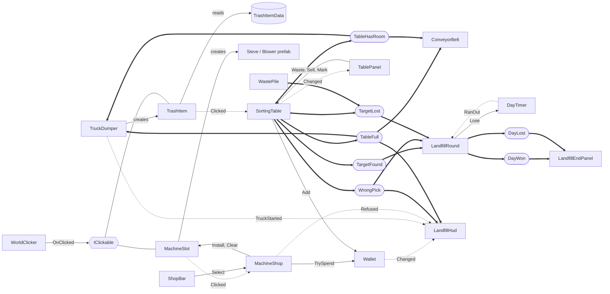

<div dir="rtl" lang="he">

# ביטקוין קבור: יום העבודה הראשון

משאיות שופכות זבל מהמזבלה על מסוע. השחקן קונה מכונות שממיינות את הזבל בשבילו, ממיין ביד את מה שמגיע לשולחן, ומחפש את המטרה של היום: ארגז כלים אדום. צריך למצוא אותו לפני שהיום נגמר, ובלי לזרוק אותו לפסולת בטעות.

מסמך העיצוב: [Buried-Bitcoin](https://github.com/Game-development-Ariel/Buried-Bitcoin)

## קישורים

* המשחק באיץ': יתווסף אחרי ההעלאה
* דיווח על שימוש בבינה מלאכותית: [AI_REPORT.md](AI_REPORT.md)

## איך מריצים

1. אחרי `git clone` מריצים `git lfs pull`, כי התמונות והצלילים שמורים ב-Git LFS.
2. ב-Unity Hub פותחים את התיקייה של המאגר, בגרסה 6000.3.25f1.
3. פותחים את הסצנה `Assets/Scenes/Landfill` ולוחצים Play.

הסצנה, הפריפאבים והנתונים נבנים מקוד ב-[LandfillSceneBuilder.cs](Assets/Scripts/Editor/LandfillSceneBuilder.cs). אחרי שינוי בכלים מריצים `Tools > Rebuild Scene`. בנייה לדפדפן: `Tools > Build WebGL`.

## איך משחקים

הכול בעכבר (או במגע):

* **חנות** (למטה משמאל): בוחרים מכונה ולוחצים על משבצת ריקה מעל המסוע. הנפה (100$) מפילה פריטים קטנים, המפוח (50$) מעיף פריטים קלים. לחיצה על מכונה שכבר הותקנה מוכרת אותה בחצי מחיר.
* **שולחן המיון** (מימין): לוחצים על פריט ובוחרים Waste, Sell או This is the target.
* כשהשולחן מלא (14 פריטים), המסוע והמשאית עוצרים עד שממיינים.
* **ניצחון**: מסמנים את ארגז הכלים האדום כמטרה.
* **הפסד**: הזמן נגמר, או שהמטרה הגיעה לפסולת (דרך מכונה או בלחיצה על Waste או Sell). בחירה לא נכונה ב-"This is the target" עולה 20 שניות.

## פיסיקה

המשחק מוצג מהצד, כדי שכוח הכבידה יעשה חלק מהמיון.

| תכונה | איפה | קובץ |
|---|---|---|
| Rigidbody2D | כל פריט שיוצא מהמשאית. הגודל והמשקל באים מהנתונים של הפריט | [TrashItem.cs](Assets/Scripts/Items/TrashItem.cs) |
| AddForce ו-AddTorque | המשאית זורקת כל פריט עם דחיפה וסיבוב | [TruckDumper.cs](Assets/Scripts/Trucks/TruckDumper.cs) |
| Collision2D | ערמת הפסולת בודקת במה היא פגעה. אם זה פריט המטרה, היום נכשל | [WastePile.cs](Assets/Scripts/Machines/WastePile.cs) |
| אפקטורים (רשות) | המסוע הוא SurfaceEffector2D. המפוח הוא AreaEffector2D בלי סקריפט בכלל: הכוח שווה לכל הפריטים, אז רק הקלים מתרוממים | [ConveyorBelt.cs](Assets/Scripts/Machines/ConveyorBelt.cs), [Blower.prefab](Assets/Prefabs/Blower.prefab) |

יש גם טריגרים שבודקים תכונות: הנפה ([Sieve.cs](Assets/Scripts/Machines/Sieve.cs)) מבטלת את ההתנגשות בין פריט קטן למסוע (`Physics2D.IgnoreCollision`), והוא נופל דרכו.

## מבנה התיקיות

<div dir="ltr">

```
Assets/
├── Scripts/
│   ├── Trucks/     TruckDumper, TruckLoad
│   ├── Items/      TrashItem, TrashItemData
│   ├── Machines/   ConveyorBelt, MachineSlot, MachineData, Sieve, WastePile
│   ├── Shop/       MachineShop, Wallet
│   ├── Sorting/    SortingTable
│   ├── Game/       LandfillRound, DayTimer, LandfillDaySettings
│   ├── Events/     GameEvent, TextEvent   (ScriptableObject)
│   ├── Input/      IClickable, WorldClicker
│   ├── UI/         LandfillHud, ShopBar, TablePanel, LandfillEndPanel, ResultOverlay, UiFactory, ...
│   ├── Audio/      Sfx
│   └── Editor/     the tools that build the scene
├── Data/           Events/, Items/, Machines/, Day1Settings
├── Prefabs/        TrashItem, Sieve, Blower
├── Scenes/  Sprites/  Resources/  Settings/
```

</div>

`Game` מחזיקה את החוקים (מתי מנצחים ומפסידים), ו-`UI` מציגה. קוד המשחק לא מכיר את קוד הממשק: הממשק מאזין לאירועים של המשחק, ולא להפך.

## יחסי המחלקות

יש שני סוגי אירועים:

* **אירוע כנכס** ([GameEvent](Assets/Scripts/Events/GameEvent.cs), [TextEvent](Assets/Scripts/Events/TextEvent.cs)): ScriptableObject שרכיב אחד מרים ואחרים מאזינים לו. השולח והמאזינים לא מכירים זה את זה.
* **אירוע רגיל של C#** (`event Action`): כשהמאזין ממילא מחזיק הפניה לשולח, כמו ה-HUD שמציג את הכסף.

כל הרשמה נעשית ב-`OnEnable` ומבוטלת ב-`OnDisable`. יוצא מן הכלל אחד: שולחן המיון נרשם ללחיצות של פריט כשהפריט נוחת עליו, ומבטל כשהפריט יורד ממנו.

בתרשים: מלבן הוא מחלקה, צורה מעוגלת היא אירוע כנכס (חץ עבה), חץ מקווקו הוא אירוע רגיל של C#, וחץ רגיל הוא קריאה ישירה.

<div dir="ltr">



</div>

| אירוע | מי שולח | מי מקבל |
|---|---|---|
| TableFull, TableHasRoom | SortingTable | ConveyorBelt (עוצר וממשיך), TruckDumper (מחכה). את TableFull מקבל גם LandfillHud |
| TargetFound, WrongPick | SortingTable | LandfillRound (ניצחון, או קנס זמן). את WrongPick מקבל גם LandfillHud |
| TargetLost | WastePile, SortingTable | LandfillRound |
| DayWon, DayLost | LandfillRound | LandfillEndPanel |
| Clicked | TrashItem, MachineSlot | SortingTable, MachineShop |
| SortingTable.Changed | SortingTable | TablePanel |
| Changed, TruckStarted, Refused, RanOut | Wallet, TruckDumper, MachineShop, DayTimer | LandfillHud, LandfillRound |

## החלטות ארכיטקטורה

**1. מבט מהצד, והפיסיקה ממיינת.** במסמך העיצוב המתקן מוצג מלמעלה, וכל מכונה הייתה צריכה קוד שמחליט לאן כל פריט הולך. מהצד, כוח הכבידה עושה את העבודה: הנפה רק מבטלת התנגשות והפריט הקטן נופל, והמפוח הוא AreaEffector2D בלי שורת קוד, שהכוח שלו מרים רק פריטים קלים. החלופה (מבט מלמעלה עם רשת ומסלולים) הייתה דורשת לכתוב את התנועה בעצמנו, והמטלה מבקשת פיסיקה.

**2. מכונות כנתונים.** כל מכונה היא נכס MachineData (שם, מחיר, תיאור) ופריפאב. החנות, המשבצות והארנק מכירים רק MachineData, ולא יודעים מה זו נפה או מפוח. החלופה הייתה `switch` על סוג המכונה בחנות, ואז כל מכונה חדשה הייתה משנה את החנות.

**3. שולחן מלא עוצר את הקו דרך אירוע.** כשהשולחן מתמלא הוא מרים `TableFull`, והמסוע, המשאית וה-HUD מגיבים כל אחד לבד. החלופה הייתה שהשולחן יחזיק הפניות למסוע ולמשאית ויקרא להם, אבל אז השולחן היה צריך להכיר כל חלק של הקו, ומכונה חדשה שצריכה לעצור הייתה משנה אותו.

כל המספרים לכוונון נמצאים בנכסים ב-`Assets/Data` (הגדרות היום והמשאיות, סוגי הפריטים, המכונות) או בשדות Inspector.

## איך מוסיפים דברים

**פריט חדש.** יוצרים נכס TrashItemData (`Create > Landfill > Trash Item`) ומוסיפים אותו למשאית בנכס [Day1Settings](Assets/Data/Day1Settings.asset). אין שינוי בקוד: הפריפאב TrashItem לוקח מהנכס צבע, גודל ומשקל, והמכונות בודקות את התכונות שבנכס.

**מכונה חדשה (המקבילה ל"אויב חדש" כאן), למשל מגנט.** סקריפט חדש `Magnet.cs` בתיקייה `Machines`, פריפאב שלו, נכס MachineData עם שם ומחיר, והוספת הנכס לרשימה של ShopBar. צריך גם להוסיף שדה `isMetal` ל-TrashItemData. החנות, המשבצות והכסף לא משתנים, כי הם מכירים רק MachineData.

## סינגלטון ומשתנים סטטיים

אין סינגלטון.

| איפה | מה | למה |
|---|---|---|
| [Sfx](Assets/Scripts/Audio/Sfx.cs) | מחלקה סטטית עם AudioSource אחד | הקליק של Play again צריך להמשיך גם כשהסצנה נטענת מחדש. אין בו מצב של המשחק |
| [ScreenFader](Assets/Scripts/UI/ScreenFader.cs) | `FadeAndLoad` סטטית ודגל `isFading` | המסך השחור חייב לשרוד את טעינת הסצנה כדי להתבהר אחריה. הדגל מונע טעינה כפולה |
| UiFactory, UiAnim, UiTheme, ResultOverlay | מחלקות סטטיות של פונקציות עזר וקבועים | אין בהן מצב |

## מה השתנה לעומת מסמך השלבים

* מבט מהצד ולא מלמעלה (ראו החלטה 1).
* שלוש משבצות קבועות למכונות במקום רשת חופשית.
* יום 1 מקוצר: שתי משאיות, שתי מכונות, ומגבלת זמן של שתי דקות וחצי כדי שיהיה תנאי הפסד.

</div>
